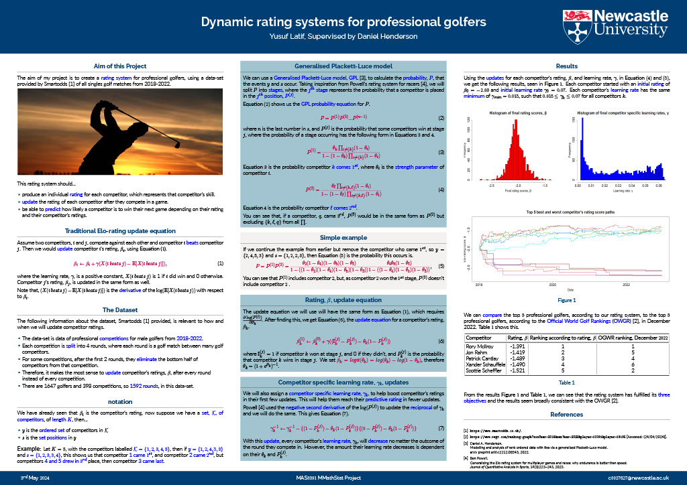

# Dynamic Rating System for Professional Golfers

In my undergraduate dissertation project, I created a rating system that ranks professional golfers and predicts competition outcomes, with ratings that update dynamically as new results come in.

## The problem
Golf rankings are usually based on points tables that don't display the skill difference between each player or the probability that they win their next competition. I wanted a model that:
- produces an **individual rating for each competitor**, which represents that competitors skill,
- **updates over time** as players compete,
- produces **probabilities** for future outcomes.

## Approach
1. **Data:** Using results from all male **professional tournaments, from 2018 - 2022**, provided by Smartodds (https://www.smartodds.co.uk/)
2. **Model:** Derived a **Generalised Plackett-Luce (GPL)** model from first principles, which uses each **competitors rating, β**, to produce a probability for each tournament outcome.
3. **Dynamic ratings:** Updates each **competitors rating, β**, after each round in a competition. Each competitor also has their own **learning rate, γ**, which helps them reach a realistic rating quickly instead of lagging behind. 
4. **Fitting & validation:** Used R to clean and format the Smartodds data and run the rating algorithm on it.

The code used is shown below, but unfortunately I cannot share the data used, as it is Smartodds confidential data. 

## Results
For the full methodology, maths, alternate models and results, [read the full dissertation](Dissertation.pdf), but the  (download for a better view) summarises the methodology and results: 


Overall, the project was successful, the model returns a skill rating, dynamically updates, predicts tournament outcomes and matches very well with the official golf rankings (shown in table 1 off the Poster).


## Final Algorithm's Functions, in R: 
```
################################################
##
##All functions
##
################################################


p.j <- function(j,theta,log=TRUE)
{
  ## calculate (log) probability that each of j "wins" at stage j
  ## here j are the indices of the competitors still in at Stage j
  
  res <- rep(0,length(j))
  theta.i <- theta[j]
  
  if(length(j)==1){
    res <- 0
  }
  else{  
    ell <- 0
    for(k in j){
      ell <- ell+1
      theta.i.not.k <- theta.i[-(match(k,j))]
      sum.log.1.minus.theta.i.not.k <- sum(log(1-theta.i.not.k))
      denom <- log(1-exp(log(1-theta[k])+sum.log.1.minus.theta.i.not.k))
      res.k <- log(theta[k])+sum.log.1.minus.theta.i.not.k-denom
      res[ell] <- res.k
    }
  }
  if(log!= TRUE){
    res <- exp(res) 
  }
  res
}


expit <- function(x){
  exp(x)/(1+exp(x))
}


t.to.s <- function(t)
{
  ## GPL model
  ## determine s from t
  
  K <- dim(t)[2]+1
  n <- dim(t)[1]
  s <- matrix(0,nrow=n,ncol=K)
  for(i in 1:n){
    s[i,] <- 1+((1:K)-cumsum(c(1,t[i,])))
  }
  s
}


s.to.t <- function(s)
{
  
  ## GPL model
  ## determine t from s
  
  K <- dim(s)[2]
  n <- dim(s)[1]
  t <- matrix(0,nrow=n,ncol=K-1)
  for(i in 1:n){
    t[i,] <- ifelse(diff(s[i,])==0,1,0)
  }
  t
}


loglike.gpl <- function(y,t,theta,m.i.star)
{
  ## Generalized (geometric) Plackett-Luce (GPL)
  ## loglikelihoods over multiple datasets
  
  n = max(dim(y)[1],1)
  if(n == 1){
    y = t(matrix(y))
    t = t(matrix(t))
  }
  ll.vec = rep(0,n)
  for(i in 1:n){
    n.i = length(y[i,y[i,]>0])
    for(j in 1:(m.i.star[i])){
      ll.vec[i] = ll.vec[i]+log(theta[y[i,j]])-log(1-exp(sum(log(1-theta[y[i,j:n.i]]))))+(1-t[i,j])*sum(log(1-theta[y[i,(j+1):n.i]])) + t[i,j]*log(1-exp(sum(log(1-theta[y[i,(j+1):n.i]]))))
    }
  }
  return(ll.vec)
}


beta.update.2nd.deriv <- function(gamma,beta.0,y,s,tt,gamma.min=0.01,gamma.max=0.05)
{
  ## perform updates of ratings based on negative second derivative
  ## and initial ratings beta.0
  
  ## number of golfers
  K <- length(beta.0)
  
  ## number of observations
  n <- dim(y)[1]
  
  ## replace NA with 0 in y  for log likelihood calculation
  yy <- ifelse(is.na(y),0,y) 
  
  ## store gamma for each golfer
  gamma.res  <- matrix(0,nrow=n,ncol=K)
  
  ## store results
  beta.res <- matrix(0,nrow=n,ncol=K)
  logscore <- rep(0,n) 
  rounds.played <- rep(0,K)
  
  beta <- beta.0
  for(i in 1:n){
    
    ## Find players in round i and last place position
    these.players <- y[i,which(is.na(y[i,])==FALSE)]
    max.s <- max(s[i,],na.rm=TRUE)
    n.players <- length(these.players)
    
    theta <- expit(beta)
    ## log score of round i
    logscore[i] <- loglike.gpl(yy[i,],tt[i,],theta,n.players-1)
    
    P <- matrix(0,nrow=K,ncol=max.s) 
    I <- matrix(NA,nrow=K,ncol=max.s)
    include <- y[i,1:n.players]
    
    ## counting each competitors rounds played
    competitors = rep(0,K)
    competitors[include] = 1
    rounds.played = rounds.played + competitors
    
    ## filling probability matrix, P, and positions matrix, I, for round i
    for(j in 1:max.s){
      P[include,j] <-  p.j(include,theta,log=FALSE)
      I[include,j] <-  0
      include <- y[i,-which(s[i,]<=j)]
      include <- include[which(is.na(include)==FALSE)]
    }
    for(j in 1:n.players){
      I[y[i,j],s[i,j]] <- 1
    }
    
    ## beta and gamma update
    deriv <- (I-P)-theta*(1-P)
    change <- rowSums(deriv,na.rm=TRUE)
    
    second.deriv <- ((I-P)-theta*(1-P))*(((1-I)-P)-theta*(1-P))
    change.gamma <- rowSums(second.deriv,na.rm=TRUE)    
    
    inv.gamma <- (1/gamma) - change.gamma
    gamma <- 1/inv.gamma
    gamma.res[i,] <- gamma
    
    ##beta <- beta+gamma*change 
    beta <- beta+(gamma.min+gamma)*change  ## put a minimum value in
    beta.res[i,] <- beta
  }
  lscore <- sum(logscore)
  return(list(beta.res=beta.res,logscore=logscore,lscore=lscore,gamma.res=gamma.res, rounds.played=rounds.played))
}

```

